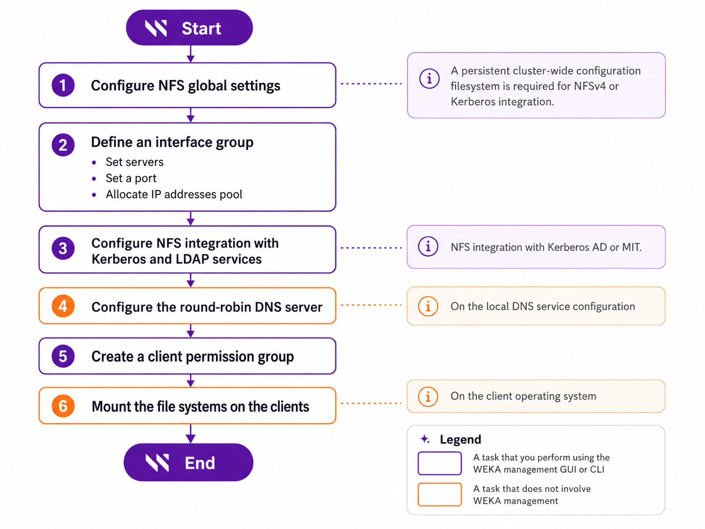

# Manage the NFS protocol

NFS (Network File System) is a protocol that enables clients to access the filesystem without requiring the WEKA client software. This leverages the standard NFS implementation of the client's operating system.

The NFS implementation is compatible with NFSv3 or NFSv4[^1] protocols and overcomes inherent limitations in the NFS protocol, including support for more than 16 user security groups and NFS file-locking.


**Multi-tenancy:** When NFS multi-tenancy is enabled, each tenant gets isolated client groups, exports, and floating IP addresses, and several NFS features become available only in the root organization. See [manage-nfs-for-tenants.md](../../operation-guide/weka-native-multi-tenancy-management/manage-nfs-for-tenants.md "mention").


## NFS service deployment high-level workflow

<figure><figcaption>
NFS service deployment high-level workflow
</figcaption></figure>

For the procedures, see [nfs-support.md](nfs-support.md "mention") or [nfs-support-1.md](nfs-support-1.md "mention").

## NFS service deployment guidelines and requirements

Adhere to the following guidelines and requirements when deploying the NFS service.

### **Configuration filesystem**

A persistent cluster-wide configuration filesystem is required for the protocol's internal operations using NFSv4 or Kerberos integration. See [#dedicated-filesystem-requirement-for-cluster-wide-persistent-protocol-configurations](../additional-protocols-overview.md#dedicated-filesystem-requirement-for-cluster-wide-persistent-protocol-configurations "mention").

### Interface groups and floating IPs

An interface group provides the floating IP addresses that NFS clients connect to, and moves them to a healthy server when a server fails. An interface group requires a minimum of two servers. See [nfs-networking-and-high-availability.md](nfs-networking-and-high-availability.md "mention").

### Round-robin DNS

Resolve a round-robin DNS name to the floating IPs, with a TTL of 0, and mount the NFS clients by that name. See [#round-robin-dns-server-configuration](nfs-networking-and-high-availability.md#round-robin-dns-server-configuration "mention").

## NFS concepts

| Topic | Description |
| --- | --- |
| [nfs-networking-and-high-availability.md](nfs-networking-and-high-availability.md "mention") | Interface groups, floating IPs, round-robin DNS, scalability, and failover. |
| [nfs-client-access-rules.md](nfs-client-access-rules.md "mention") | IP, DNS, and netgroup rules that control which clients reach an export. |
| [nfs-authentication-identity-and-acls.md](nfs-authentication-identity-and-acls.md "mention") | Kerberos authentication, user and group resolution from a directory, and ACL flavors. |
| [nfs-server-resources.md](nfs-server-resources.md "mention") | Client connections, open files, and memory of each NFS container, and the behavior at each maximum. |
| [nfs-external-load-balancer-integration.md](nfs-external-load-balancer-integration.md "mention") | The health API that tells an external load balancer which NFS containers are serving. |
| [nfs-file-locking.md](nfs-file-locking.md "mention") | Byte-range advisory locking and the NFSv3 locking prerequisites. |

**Related topics**

[nfs-support.md](nfs-support.md "mention")

[nfs-support-1.md](nfs-support-1.md "mention")

[supported-nfs-client-mount-options.md](supported-nfs-client-mount-options.md "mention")

[manage-nfs-for-tenants.md](../../operation-guide/weka-native-multi-tenancy-management/manage-nfs-for-tenants.md "mention")

[^1]: NFSv4.0 and NFSv4.1
