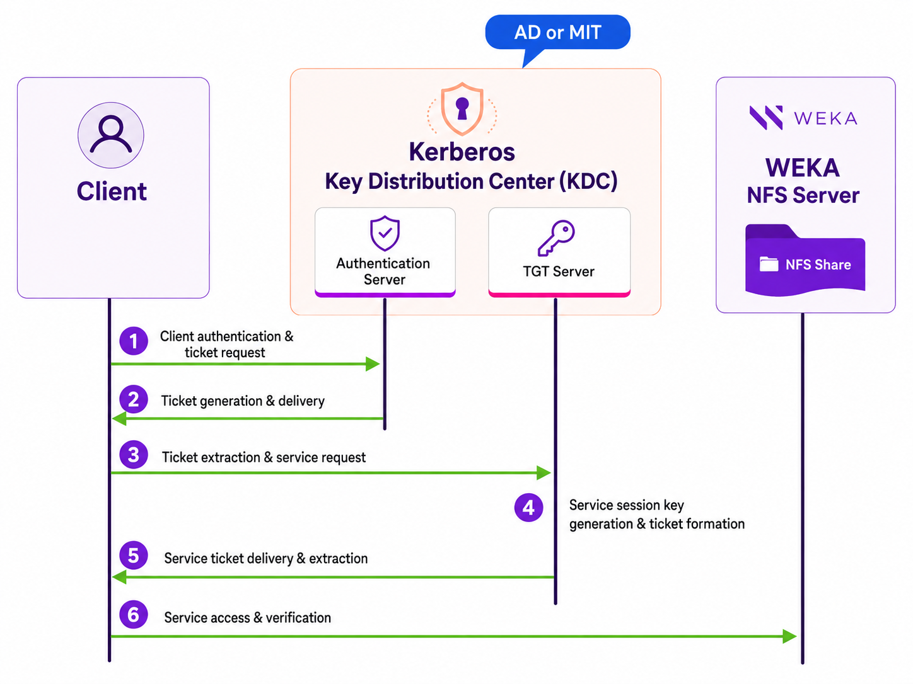

# NFS authentication, identity, and ACLs

The NFS service can authenticate clients with Kerberos, resolve user and group names and IDs from a directory service, and enforce Access Control Lists (ACLs) on files and directories.

## NFS integration with Kerberos service

NFS integrates with an existing Kerberos service to provide client authentication, data integrity, and data privacy over the wire, ensuring robust security even across untrusted networks.

The Kerberos security levels are:

* **krb5:** Implements basic Kerberos authentication.
* **krb5i:** Incorporates Kerberos authentication with data integrity assurance.
* **krb5p:** Integrates Kerberos authentication with data integrity and privacy measures.


NFS exports created before configuring Kerberos are not updated automatically when using Kerberos. The Authenticator Type must be modified to one of the Kerberos types to leverage the Kerberos advantages.



**Multi-tenancy:** Kerberos is available only in the root organization. Tenant connections that attempt `RPCSEC_GSS` are rejected with `AUTH_TOOWEAK`, and tenant mounts use `sec=sys` only. The Kerberos flavors are also removed from the tenant view of `weka nfs global-config`, so a cluster administrator and a tenant administrator running that command see different output. See [manage-nfs-for-tenants.md](../../operation-guide/weka-native-multi-tenancy-management/manage-nfs-for-tenants.md "mention").


### Kerberos LDAP configurations

Kerberos authentication for NFS is supported using AD and Kerberos MIT:

* **Active Directory (AD):** NFS integrates with Active Directory (AD), which includes built-in Kerberos services. The system interacts with the AD using the Kerberos protocol to authenticate service requests among trusted devices.
* **Kerberos MIT:** NFS integrates with Kerberos MIT, implementing the Kerberos protocol, which uses secret-key cryptography for authentication across insecure networks. This protocol is widely standardized and utilized.


**Realm consistency:** The NFS service is registered in one Kerberos realm. The NFS clients and the Key Distribution Center (KDC) reside in the same realm as the NFS service.


### Kerberos service interactions basic outline

The following Kerberos service interactions ensure secure communication between the client and the NFS server:

1. **Client authentication and ticket request:** The client sends a request, including encrypted credentials, to the Authentication Server for a Ticket Granting Ticket (TGT).
2. **Ticket generation and delivery:** The Authentication Server verifies the client’s identity, generates a session key, forms a TGT, and sends these to the client.
3. **Ticket extraction and service request:** The client decrypts the received message, extracts the session key and the TGT, and sends a service request to the Ticket Granting Server.
4. **Service session key generation & ticket formation:** The Ticket Granting Server verifies the TGT, generates a Service Session Key, and forms a Service Ticket.
5. **Service ticket delivery & extraction:** The Ticket Granting Server sends the Service Ticket and the Service Session Key to the client, who then decrypts the response and extracts these for later use.
6. **Service access & verification:** The client generates an authenticator for the network service and sends it along with the Service Ticket to the network service, which then verifies the Service Ticket and the authenticator.

<figure><figcaption>
Kerberos service interactions (simplified view)
</figcaption></figure>


This diagram illustrates the Kerberos service interactions in a simplified manner. It highlights how secure communication is established over insecure networks. Note that this is a broad representation, and actual implementations may differ.


## NFS user and group resolution

The NFS service resolves user and group names and IDs for NFSv4 ownership, ACLs, Kerberos principals, and manage-gids. With manage-gids, the NFS server looks up a user's supplementary groups instead of using the up to 16 groups that the client sends. Each NFS container runs its own identity service (SSSD), configured with `weka nfs ldap`.

| Mode | Command | Directory | How the cluster connects to the directory |
| --- | --- | --- | --- |
| Active Directory with Kerberos | `weka nfs ldap setup-ad`, after `weka nfs kerberos registration setup-ad` | Active Directory | The machine account of the NFS service, through its keytab |
| Active Directory without Kerberos | `weka nfs ldap setup-ad-nokrb` | Active Directory | A machine account that the command creates, through its keytab |
| OpenLDAP | `weka nfs ldap setup-openldap` | OpenLDAP or another RFC 2307 LDAP directory | A read-only bind user and its password |
| On-host | `weka nfs ldap setup-onhostldap` | The directory that the server's own SSSD uses | The configuration of each server |

The identity configuration is stored on the NFS configuration filesystem, so every NFS container uses the same configuration. Set the configuration filesystem before you configure any mode.

**Several Active Directory domains**

After `setup-ad` or `setup-ad-nokrb`, the identity service discovers the other domains of the Active Directory forest, so users and groups from other domains of the forest resolve without more configuration, provided that their POSIX attributes are readable through the Global Catalog. To list the domains explicitly, see [#add-active-directory-domains](nfs-support-1.md#add-active-directory-domains "mention").

**Considerations**

* User and group IDs come from the POSIX attributes `uidNumber` and `gidNumber`, not from Active Directory SIDs. Populate these attributes for every user and group that accesses NFS.
* An OpenLDAP configuration supports a single domain.
* To use Active Directory without Kerberos on a cluster with a Kerberos registration, reset the Kerberos registration first.
* Exports with manage-gids need a working identity source on each NFS server. The cluster raises the `NfsIdentitySourceUnavailable` alert for a server without one.
* The on-host mode uses the SSSD service of each server. Keep SSSD running on every NFS server.
* Changing the identity or Kerberos configuration can restart the NFS containers, which pauses I/O for connected clients. See [#integrate-the-nfs-and-kerberos-service](nfs-support-1.md#integrate-the-nfs-and-kerberos-service "mention").
* The cluster user and the directory accounts need specific roles and privileges. See [#required-roles-and-directory-privileges](nfs-support-1.md#required-roles-and-directory-privileges "mention").
* To verify the certificate of the directory server, see [#verify-the-directory-server-certificate](nfs-support-1.md#verify-the-directory-server-certificate "mention").

## Access Control List (ACL) in NFS

Access Control List (ACL) in NFS (Network File System) provide fine-grained control over file permissions, offering more flexibility than traditional POSIX permissions. NFS supports multiple ACL flavors, each serving different use cases and interoperability needs.


To enable ACL functionality, you must configure LDAP to manage user and group information.



**Multi-tenancy:** ACLs are available only in the root organization. On a tenant export, an explicitly requested ACL type is rejected, and an ACL type left at its default is silently set to `NONE`. An export created without naming an ACL type therefore has weaker access control than the default described here. See [manage-nfs-for-tenants.md](../../operation-guide/weka-native-multi-tenancy-management/manage-nfs-for-tenants.md "mention").


**ACL flavors in NFS**

NFS supports the following ACL flavors:

* **None**: No ACL enforcement or updates occur, even if POSIX ACLs exist on a file or directory. This flavor is used when ACL management is unnecessary.
* **POSIX**: NFS enforces POSIX ACLs, ensuring compatibility with other protocols. However, the finer granularity of NFSv4 ACLs is lost when mapped to POSIX ACLs. This option is suitable for environments requiring basic ACL management across multiple protocols.
* **NFSv4**: NFSv4 ACLs are enforced directly, without mapping to POSIX ACLs. This flavor preserves the full granularity of NFSv4 ACLs but does not support interoperability with other protocols. ACLs are stored as extended attributes and mapped to user and group IDs (UID/GID). Use NFSv4 when full NFSv4 ACL granularity is required, and interoperability with other protocols is not a concern.
* **Hybrid**: This flavor combines both POSIX and NFSv4 ACLs to support interoperability. NFS ensures consistency between the two ACL flavors, and if any inconsistency arises, POSIX ACL is used for enforcement. Hybrid is ideal for environments requiring both interoperability and full NFSv4 ACL functionality.


**NFSv3 and ACLs:** The NFSv3 implementation does not support ACLs. Access control for NFSv3 clients is enforced by the underlying filesystem using standard POSIX file permissions.


**Where ACLs are set**

The default ACL flavor is part of the NFS global settings, and each NFS permission (export) can set its own ACL flavor. Changes to ACL settings may require restarting the NFS containers. ACL flavors and related configurations are stored in the configuration filesystem, so the permissions are managed consistently across the cluster. See [#configure-the-nfs-global-settings](nfs-support-1.md#configure-the-nfs-global-settings "mention") and [#manage-nfs-client-permissions](nfs-support-1.md#manage-nfs-client-permissions "mention").


**ACL flavors and shared filesystems:** NFS exports backed by the same filesystem must use the same ACL flavor. To use ACL flavors (POSIX, NFSv4, or Hybrid), ensure all exports on that filesystem use NFSv4.


**Upgrading and ACLs**

When upgrading, the default ACL flavor for all permissions sets to **POSIX**. ACLs are enabled by default. To ensure proper ACL functionality, both `.config_fs` and LDAP must be configured.

**Related topics**

[#integrate-the-nfs-and-kerberos-service](nfs-support.md#integrate-the-nfs-and-kerberos-service "mention") (GUI)

[#integrate-the-nfs-and-kerberos-service](nfs-support-1.md#integrate-the-nfs-and-kerberos-service "mention") (CLI)
