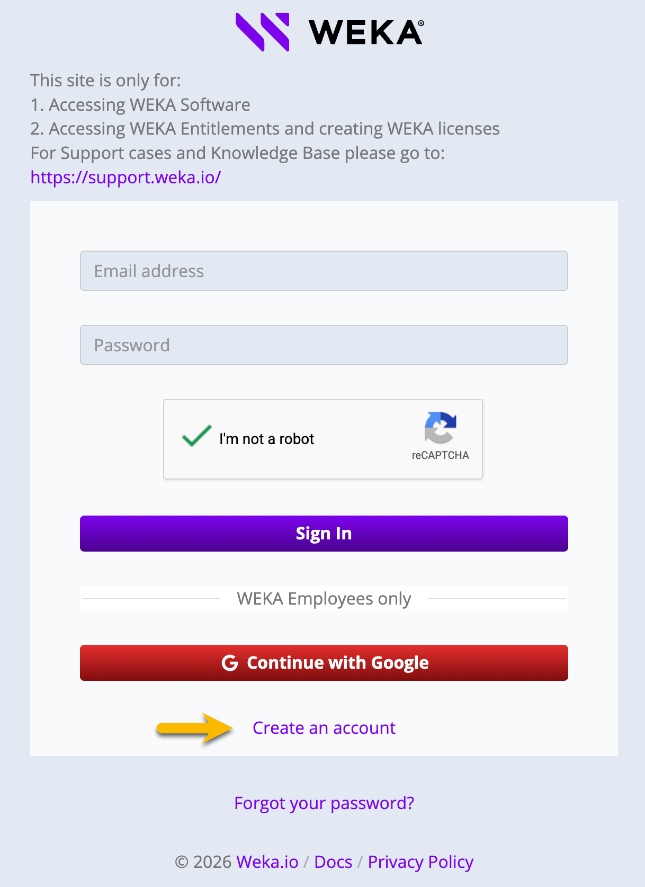
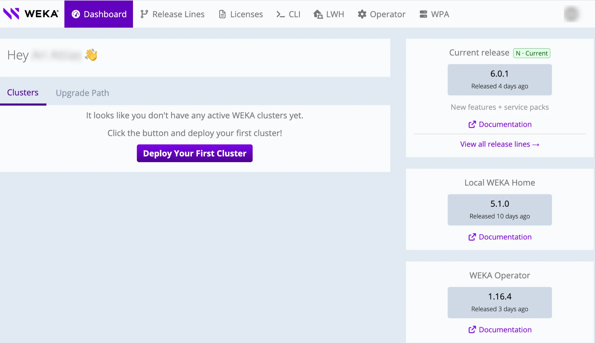
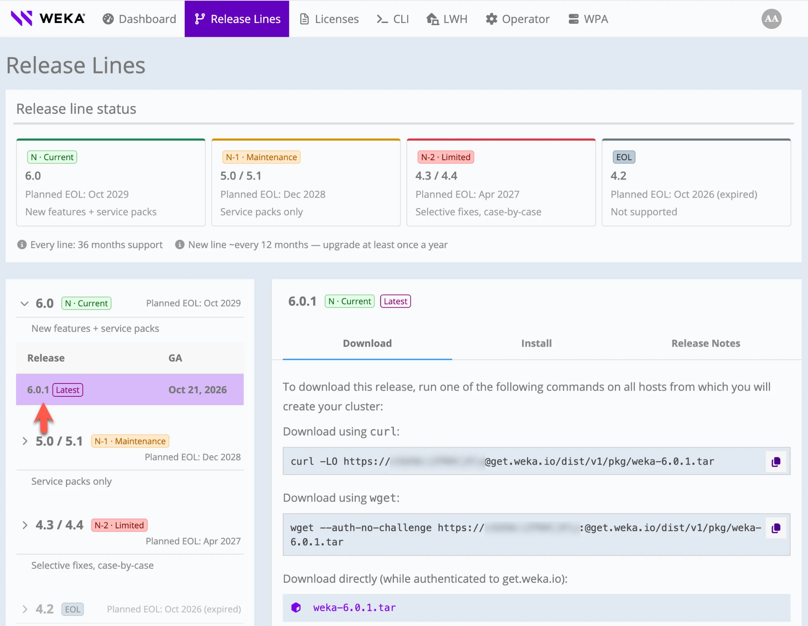

# Obtain the installation packages

## Register with get.weka.io

Register with [get.weka.io](https://get.weka.io/ui/dashboard) before downloading installation packages.

**Before you begin:** Use an organization email address. Personal email addresses are not supported. Skip these steps if you already have a get.weka.io account.

**Procedure**

1. Open [get.weka.io](https://get.weka.io/ui/dashboard), then select **Create an account**.

2. Enter your organization email address. Select **I’m not a robot**, then select **Send Registration Email**.
3. Open the registration email from WEKA. Select its confirmation link.
4. Enter your email address, full name, and password. Then select **Create Account**.

WEKA reviews your request. Sign in after you receive the approval email.

## Download the WEKA installation packages

Download the package for your installation path.

**Before you begin:** Register with get.weka.io and receive approval. Identify whether you install with WSA or manually.

**Procedure**

1. Open [get.weka.io](https://get.weka.io/ui/dashboard), then sign in.

The dashboard shows the current release, Local WEKA Home, and the WEKA Operator, with a link to all release lines.

<figure><figcaption>
get.weka.io dashboard
</figcaption></figure>

2. Download the required package:
   * For automated installation with WSA, contact the Customer Success Team to get the WSA image.
   * For manual installation, select the **Release Lines** tab. Expand the release line, select the release, and then on the **Download** tab, download the WEKA software tarball.

The download link includes an access token. The capture masks this token.

<figure><figcaption>
Release Lines download page
</figcaption></figure>

## Continue installation

Continue with the installation path that matches the downloaded package:

* WSA image: [Install WSA](install-the-weka-cluster-using-the-wsa.md)
* WEKA software tarball: [Install OS and WEKA software](manually-install-os-and-weka-on-servers/)
