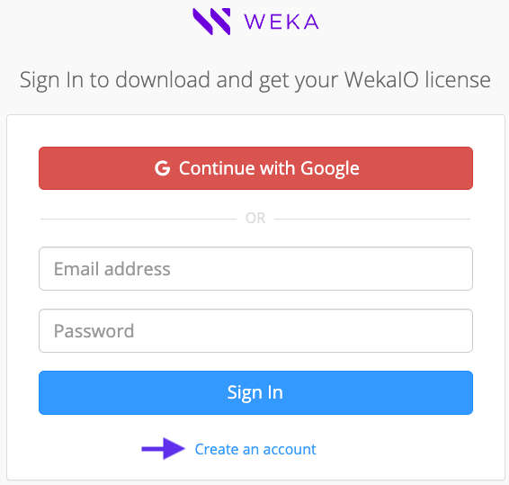
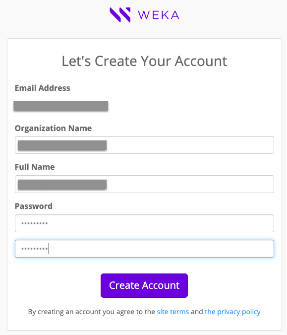
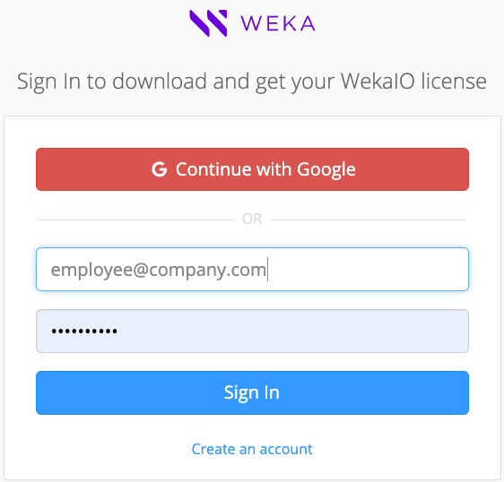

# Obtain the WEKA installation packages

## **Register to get.weka.io**

To sign in to [get.weka.io](http://get.weka.io), you first need to create an account and fill in your details. If you already have a registered account for get.weka.io, skip this procedure.

**Procedure**

1. Go to the [get.weka.io](https://get.weka.io/ui/dashboard) download site, and select **Create an account.**

The Send Registration Email page opens.

2\. Fill in your organization's email address (private mail is prohibited).\
Select **I’m not a robot**, and then select **Send Registration Email.**

3\. Check your inbox for a registration email from Weka.io.\
To confirm your registration, select the link.\
The Create Your Account page opens.

4\. Fill in your email address, full name, and password. Then, select **Create Account**.

Your request for access to [get.weka.io](http://get.weka.io) is sent to WEKA for review. Wait for a validation email. Once your registration is approved, you can sign in to [get.weka.io](http://get.weka.io).

## **Download the** WEKA **installation packages**

Download the required WEKA installation packages according to the workflow path.

* Path A (automated with WMS and WSA): Download the WMS and WSA ISOs from [get.weka.io](https://get.weka.io/ui/dashboard). The WMS is downloaded from a dedicated dropdown. The WSA is found in the relevant release page.
* Path B (automated with WSA): Download the WSA package from [get.weka.io](https://get.weka.io/ui/dashboard) The WSA is found in the relevant release page.
* Path C (manual installation and configuration): Download the WEKA software tarball from [get.weka.io](https://get.weka.io/ui/dashboard). The tarball is found in the relevant release page.

You can only sign in and download the packages if you are a registered user.

**Procedure: Download from get.weka.io**

1. Go to the [get.weka.io](https://get.weka.io/ui/dashboard) download site, and sign in with your registered account.

[get.weka.io](http://get.weka.io) page opens.

<figure><figcaption>
get.weka.io dashboard
</figcaption></figure>

2. Do one of the following:
   * Select the required package from the dashboard.
   * Select the **Release Lines** tab. Expand the release line, select the release, and then on the **Download** tab, copy the `curl` or `wget` command, or select the file to download it directly.\
     (The token in the download link is purposely blurred.)

<figure><figcaption>
Release Lines download page
</figcaption></figure>

## What to do next?

Depending on the workflow path you follow, go to one of the following:

[install-the-weka-cluster-using-the-wms-with-wsa.md](install-the-weka-cluster-using-the-wms-with-wsa.md "mention") (path A)

[install-the-weka-cluster-using-the-wsa.md](install-the-weka-cluster-using-the-wsa.md "mention") (path B)

[manually-install-os-and-weka-on-servers](manually-install-os-and-weka-on-servers/ "mention") (path C)
