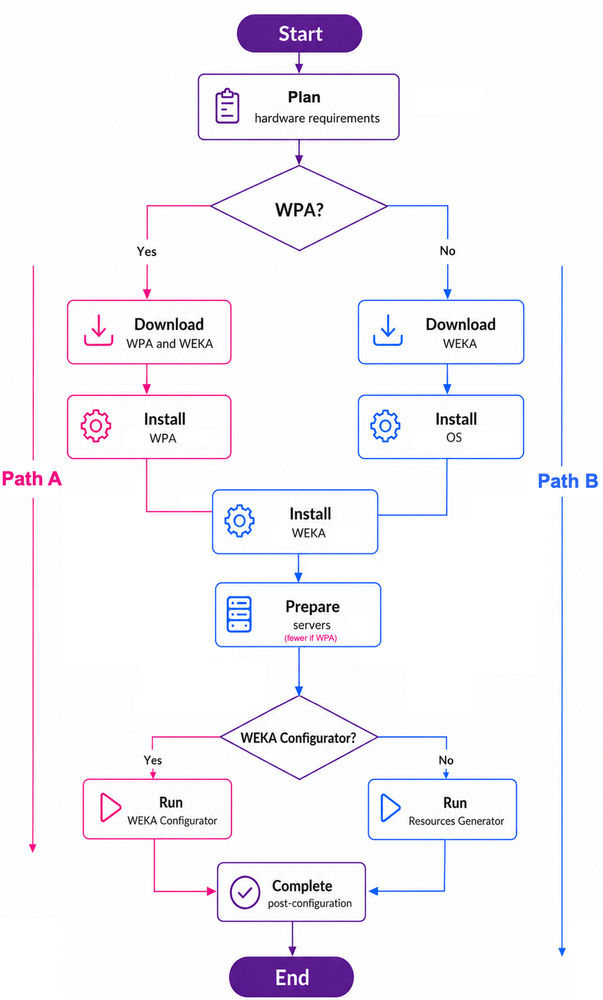

# System installation on bare metal servers

## Choose an installation path

WEKA supports two installation paths for bare metal servers:

* Path A: Automated operating system installation with the WEKA Platform Appliance (WPA).
* Path B: Manual installation with an operating system and tools of your choice.

### Path A: Automated operating system installation with WPA

WEKA Platform Appliance (WPA): an operating system image based on Ubuntu 24.04 Server Minimal, with the packages and system settings that the WEKA software requires.

WPA installs and configures the operating system automatically, with no internet access required. After WPA, install the WEKA software and complete the remaining system preparation steps, such as networking and clock synchronization.

Use this path when Ubuntu 24.04 meets your deployment requirements.

### Path B: Manual installation

Use this path if:

* You want to use a different operating system.
* You need a customized server image.

Download the WEKA software, install the operating system and WEKA software, and prepare the servers.


The manual installation workflow requires deep knowledge of WEKA architecture. Visit WEKA U for training material. Sign-in is required.


## High-level deployment workflow

Review the deployment workflow for a group of bare metal servers.

<figure><figcaption>
High-level deployment workflow
</figcaption></figure>

### Continue with cluster configuration

Once the servers are ready, choose the configuration method that matches your installation path:

* Path A: Run the WEKA Configurator. WPA includes it under `/opt/tools/install`, and it generates the cluster configuration script.
* Path B: Run the WEKA Configurator for guided setup, or run the Resources Generator to generate the resource files required for manual container creation on the cluster servers.

All supported configuration methods lead to the same next step: completing post-configuration.

Frequently asked questions

1. What are the WPA sign-in credentials?
   * WPA sets passwords for the `root` and `weka` users. Find them under **OS login** on the WPA download page on [get.weka.io](https://get.weka.io). Change both passwords after installation.
2. Can we choose the number of cores and containers to use?
   * Yes. Set them during cluster configuration.
3. Does WPA mirror the boot drives?
   * No. When WPA finds two installation drives of the same size, it installs the operating system on the first drive and uses the second drive for `/opt/weka`. When the server has a hardware RAID virtual disk or a Dell BOSS device, WPA installs on it.
4. Can I set up WEKA with 8 SSDs per server even though I have 12 installed?
   * Not automatically. Pull the drives or manually adjust the configuration before running it. Edit the `config.sh` output from `wekaconfig`.
5. What must be done to set up High Availability (HA)? How about no HA?
   * Set that during cluster configuration with `wekaconfig`.
6. If there are multiple NIC cards (for WEKA and Ceph), how do I choose the NICs to use for the WEKA backend server?
   * Configure the required dataplane interfaces and routes during cluster configuration.
7. Does WPA change the licensing process?
   * No. Licensing is the same for both installation paths.
8. Does WPA configure the dataplane IP addresses?
   * No. Configure the dataplane networking when you prepare the system.
9. What needs to be configured for Ethernet or InfiniBand?
   * Set the network interfaces, IP addresses, routes, and related cluster settings during configuration.
10. What is required after the WPA installation?
    * Install the WEKA software, complete the remaining system preparation steps, validate the environment, and build the cluster.

## What to do next?

Go to [Plan hardware requirements](plan-hardware-requirements.md).
