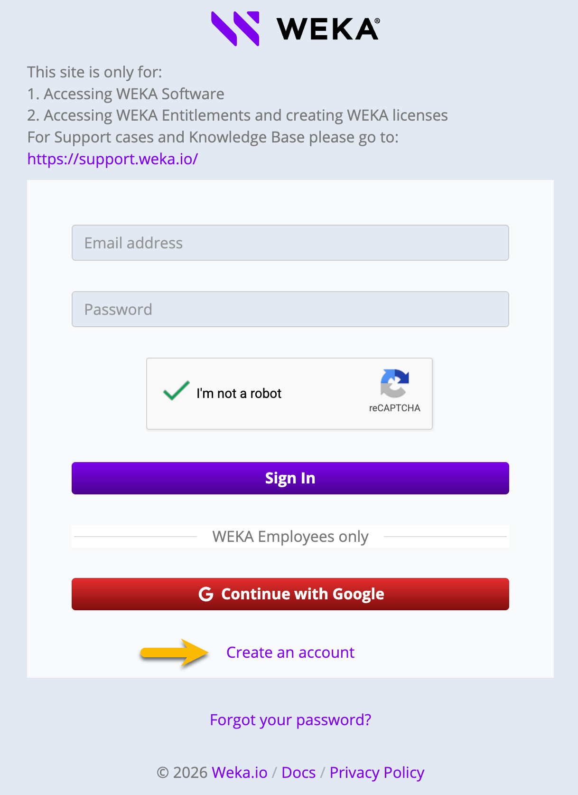
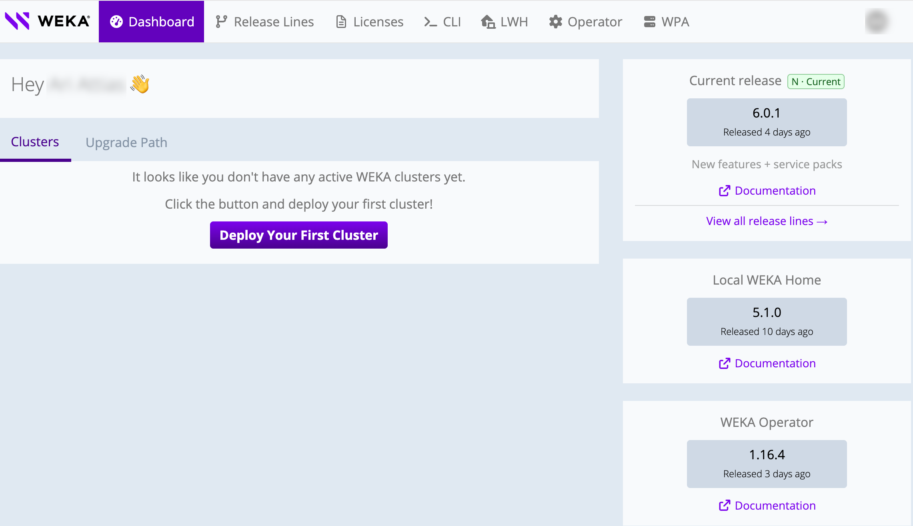

# Obtain the installation packages

## Register to get.weka.io

Create a [get.weka.io](https://get.weka.io/ui/dashboard) account before you download installation files. If you already have an account, skip this section.

**Procedure**

1. Go to the [get.weka.io](https://get.weka.io/ui/dashboard) download site, and select **Create an account.**

The Send Registration Email page opens.

2\. Fill in your organization's email address (private mail is prohibited).\
Select **I’m not a robot**, and then select **Send Registration Email.**

3\. Check your inbox for a registration email from Weka.io.\
To confirm your registration, select the link.\
The Create Your Account page opens.

4\. Fill in your email address, full name, and password. Then, select **Create Account**.

Your request for access to [get.weka.io](http://get.weka.io) is sent to WEKA for review. Wait for a validation email. Once your registration is approved, you can sign in to [get.weka.io](http://get.weka.io).

## Download the WEKA installation packages

Download the packages that match your installation path.

* Automated operating system installation with WPA: Download the WPA ISO image from the [WPA page](https://get.weka.io/ui/wpa/) on get.weka.io, and the WEKA software tarball.
* Manual installation and configuration: Download the WEKA software tarball.

You can only sign in and download the packages if you are a registered user.

**Procedure: Download from get.weka.io**

1. Go to the [get.weka.io](https://get.weka.io/ui/dashboard) download site, and sign in with your registered account.

<figure><figcaption>
get.weka.io dashboard
</figcaption></figure>

2. Download the required package:
   * Select the package from the dashboard.
   * Or, select the **Release Lines** tab. Expand the release line, select the release, and then on the **Download** tab, copy the `curl` or `wget` command, or select the file to download it directly.

The download-link token is intentionally blurred in the image.

<figure><figcaption>
Release Lines download page
</figcaption></figure>

3\. If you use WPA, download the WPA ISO image from the [WPA page](https://get.weka.io/ui/wpa/), and verify it against the MD5 checksum in the WPA release notes.

## What to do next?

Depending on the installation path you follow, go to one of the following:

* Path A: [Install WPA](install-wpa.md)
* Path B: [Install the operating system](install-the-operating-system.md)
