# Manage asynchronous replication using the GUI

Manage asynchronous replication from the **Replication** page. A typical setup links the two clusters, creates a replication pair for each filesystem to protect, and then monitors the pairs on the **Replication Dashboard**.

The **Replication** page appears in the menu when the cluster has the replication license. It has two tabs:

* **Replication Dashboard:** The replication pairs of this cluster, in both roles, with their policy, progress, and status.
* **Replication Links:** The links from this cluster to other clusters.

After setup, the **Replication Dashboard** shows the number of linked clusters, the health of all pairs, the next scheduled sync, and a row for each pair.

<figure>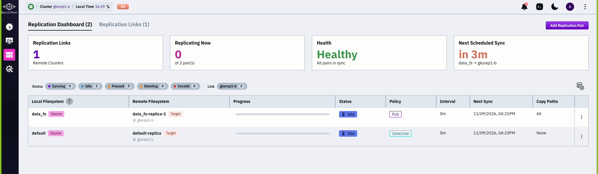<figcaption>
Replication Dashboard with a Full Data Replication pair and a Selective Replication pair
</figcaption></figure>

| Task                                                                                                                        | Description                                                                                                    |
| --------------------------------------------------------------------------------------------------------------------------- | -------------------------------------------------------------------------------------------------------------- |
| [Link the clusters](manage-asynchronous-replication-using-the-gui.md#link-the-clusters)                                     | Connect to a remote cluster, verify its identity, and create the first replication pair.                       |
| [Create a replication pair](manage-asynchronous-replication-using-the-gui.md#create-a-replication-pair)                     | Replicate a local filesystem to a linked cluster with a Full Data Replication or Selective Replication policy. |
| [View replication pairs](manage-asynchronous-replication-using-the-gui.md#view-replication-pairs)                           | Monitor the status, progress, and next scheduled sync of each pair.                                            |
| [Edit the replication policy](manage-asynchronous-replication-using-the-gui.md#edit-the-replication-policy)                 | Change the policy, paths to pre-copy, sync interval, or restore points of a pair.                              |
| [Pause and resume a replication pair](manage-asynchronous-replication-using-the-gui.md#pause-and-resume-a-replication-pair) | Stop and restart the replication schedule, for example before maintenance.                                     |
| [Delete a replication pair](manage-asynchronous-replication-using-the-gui.md#delete-a-replication-pair)                     | Remove a pair after pausing it.                                                                                |
| [Update a replication link](manage-asynchronous-replication-using-the-gui.md#update-a-replication-link)                     | Rediscover a remote cluster after its management address or port changes.                                      |
| [Remove a replication link](manage-asynchronous-replication-using-the-gui.md#remove-a-replication-link)                     | Remove a link after deleting every pair that uses it.                                                          |

## Link the clusters

Link the two clusters so they can authenticate each other and replicate filesystems. One link carries replication in both directions.

**Before you begin**

* Configure an S3 cluster on both clusters. Until an S3 cluster exists, **Add Replication Link** is unavailable. See [s3](../../additional-protocols/s3/ "mention").
* Get the management address of the other cluster, and the user name and password of a cluster admin on it.
* Get the TLS certificate fingerprint of the other cluster. On that cluster, run `weka security tls status`.
* Make sure that the clusters can reach each other over the management network (port 14000 by default) and each cluster's S3 port (9000 by default).
* Make sure that the S3 servers on both clusters do not run the NFS or SMB protocols. Replication is not supported on servers that run NFS or SMB.
* Keep the clocks of the two clusters synchronized to within 5 minutes of each other, for example with NTP.

**Procedure**

1. From the menu, select **Manage > Replication**.
2. Select **Add Replication Link**.

<figure>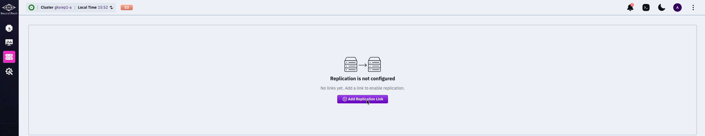<figcaption>
Add Replication Link
</figcaption></figure>

3. In the **Replication Link** step:
   1. Enter the **Management Address** of the other cluster, as a host or host:port.
   2. Enter the **User Name** and **Password** of a cluster admin on it.
   3. Select **Next - Verify Peer Cluster Identity**.

<figure><figcaption>
Create Replication Link: Replication Link step
</figcaption></figure>

4. Verify that the **SHA256 Fingerprint** matches the fingerprint of the remote cluster:
   1. Using a terminal, connect to the remote cluster.
   2. Run `weka security tls status`.
   3. Verify that the SHA256 value in the output matches the **SHA256 Fingerprint** in the wizard.
   4. If they match, select **Next - Replication Policy**. If they don't match, select **Cancel**.

<figure>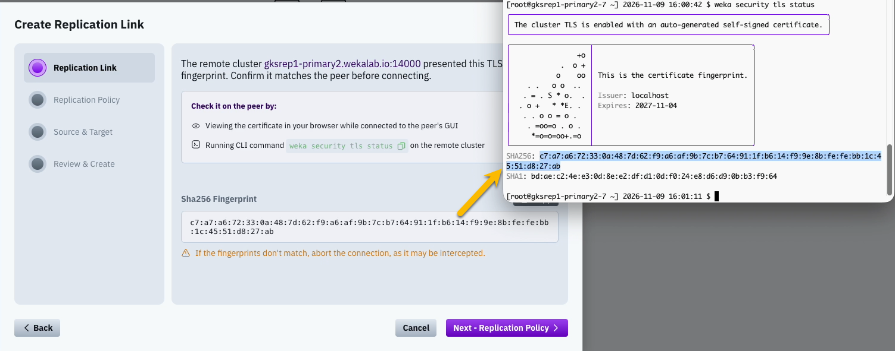<figcaption>
Create Replication Link: peer fingerprint check
</figcaption></figure>

5. In the **Replication Policy** step:
   1. Select one of the following options:
      * **Full Data Replication:** Copies all data to the target before each snapshot becomes accessible. After a failover, the target has all data up to the last replicated snapshot.
      * **Selective Replication:** Replicates metadata, and copies file data to the target when files are accessed. To copy directories in advance, add them in the next step.
   2. Set the following parameters:
      * **Schedule:** The schedule for the replication. Only **Interval** is available.
      * **Sync Interval:** How often the pair starts a replication cycle, from 5 minutes to 30 days.
      * **Restore Points on Target:** Number of snapshots to retain, from 2 to 25. Default: 3. Retaining more snapshots requires more storage. Enforced only while the pair is running. See [Pause and resume a replication pair](manage-asynchronous-replication-using-the-gui.md#pause-and-resume-a-replication-pair).
   3. Optional: To start the first replication cycle now, select **Start Replication immediately**.
   4. Select **Next - Source & Target**.

<figure>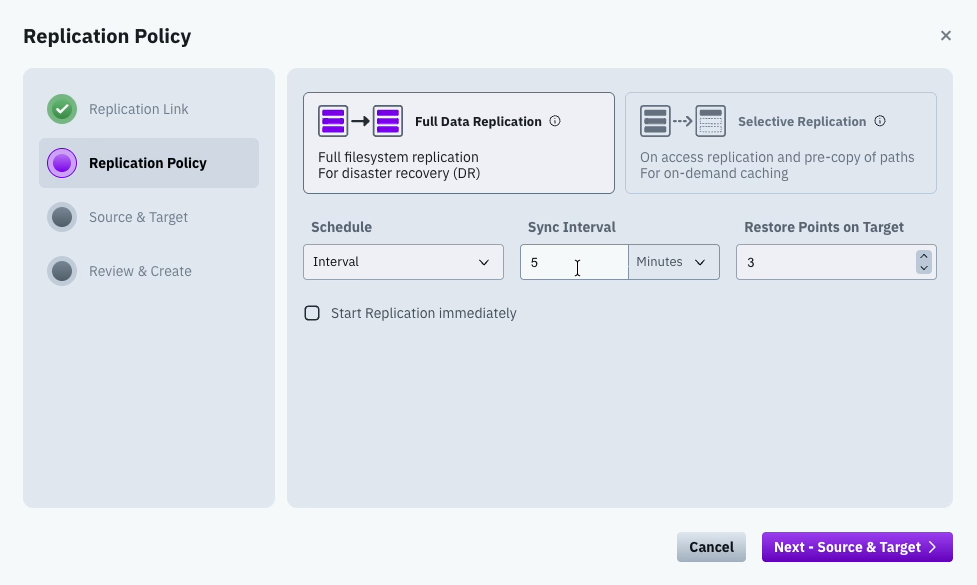<figcaption>
Create Replication Link: Replication Policy step (Full Data Replication)
</figcaption></figure>

6. In the **Source & Target** step:
   1. Select the source filesystem to replicate.
   2. Enter the target filesystem name on the remote cluster.
   3. Set the size of the filesystem to occupy on the remote cluster.
   4. For Selective Replication, enter each pre-copy directory in Paths to Pre-Copy. Start each path with /, and press Enter or type a comma.
   5. Select **Next - Review & Create**.

<figure>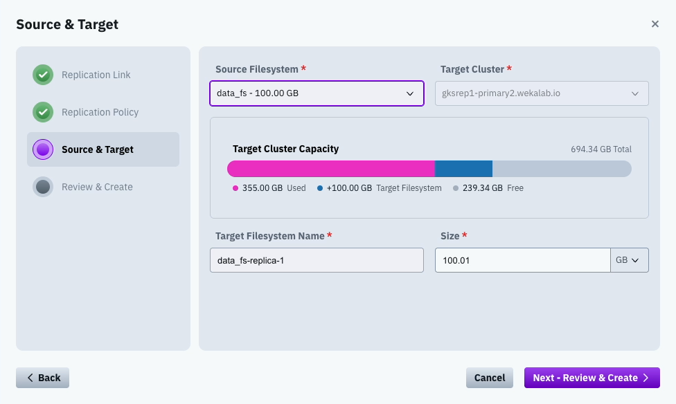<figcaption>
Create Replication Link: Source &#x26; Target step
</figcaption></figure>

7. In the **Review & Create** step, review the replication policy details. Then, select **Create Replication Pair**.

<figure>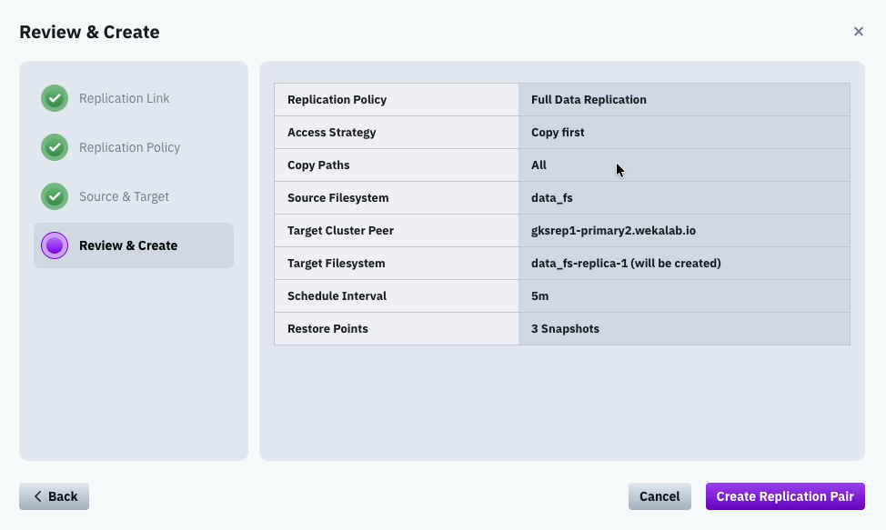<figcaption>
Create Replication Link: Review &#x26; Create step
</figcaption></figure>

8. Select the **Replication Links** tab, and verify that the new link shows **Connected** in **Connection**.\
   Each row shows the **Local Cluster**, **Remote Cluster**, **Remote Address**, **Connection**, and **Replication Pairs**. Link status can be **Connected**, **Degraded**, **Disconnected**, **Unpaired**, or **Unknown**.

<figure>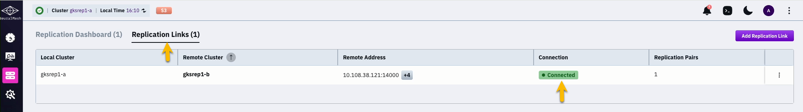<figcaption>
Replication Links
</figcaption></figure>

## Create a replication link

Create a replication link from the source cluster to each additional target cluster. Each link establishes trust between the two clusters.

**Procedure**

1. From the menu, select **Manage > Replication**. Then, select the **Replication Links** tab.
2. Select **Add Replication Link**.

<figure>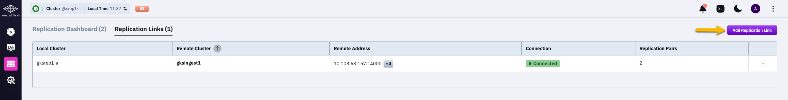<figcaption>
Add Replication Link
</figcaption></figure>

3. In the **Add Peer Cluster** step:
   1. Enter the **Management Address** of the other cluster, as a host or host:port.
   2. Enter the **User Name** and **Password** of a cluster admin on it.
   3. Select **Next - Verify Peer Cluster Identity**.

<figure>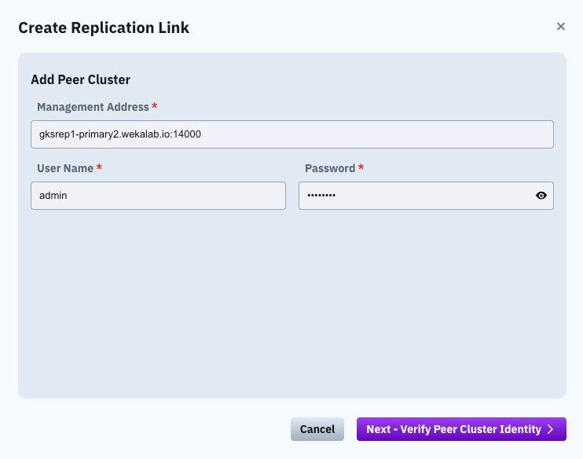<figcaption>
Add Replication Link: Add Peer Cluster step
</figcaption></figure>

4. Verify that the **SHA256 Fingerprint** matches the fingerprint of the remote cluster:
   1. Using a terminal, connect to the remote cluster.
   2. Run `weka security tls status`.
   3. Verify that the SHA256 value in the output matches the **SHA256 Fingerprint** in the wizard.
   4. If they match, select **Create Replication Link**. If they don't match, select **Cancel**.

<figure>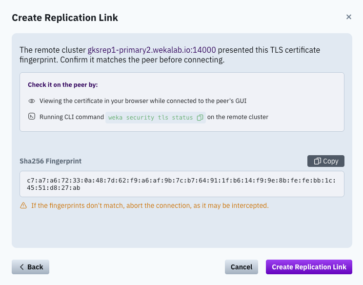<figcaption>
Add Replication Link: Verify SHA256 Fingerprint
</figcaption></figure>

## Create a replication pair

Create a replication pair to replicate a local filesystem to a linked cluster. The target filesystem is created on the other cluster during the first replication cycle.

**Before you begin**

* Link the clusters. The link must show **Connected**.
* For **Selective Replication** with **Paths to Pre-Copy**, make sure that the target cluster has a Data Services container.

**Procedure**

1. From the menu, select **Manage > Replication**, and then select **Add Replication Pair**.
2. In the **Replication Policy** step, select a policy:
   * **Full Data Replication:** Copies all data to the target before each snapshot becomes accessible. Use it for disaster recovery.
   * **Selective Replication:** Replicates metadata, and copies file data to the target when files are accessed. To copy directories in advance, add them in the next step.
3. Set the **Sync Interval**, from 5 minutes to 30 days, and the number of **Restore Points on Target**.
4. Optional: To start the first replication cycle now, select **Start Replication immediately**.
5. Select **Next - Source & Target**.
6.  In the **Source & Target** step:

    1. Select the **Source Filesystem** and **Target Cluster**.
    2. Enter the **Target Filesystem Name** and **Size**.
    3. For **Selective Replication**, enter each pre-copy directory in **Paths to Pre-Copy**. Start each path with `/`, and press **Enter** or type a comma.
    4. Select **Next - Review & Create**.

    For Full Data Replication, the target size must be at least the source filesystem size. **Target Cluster Capacity** shows the available space on the target cluster.

<figure>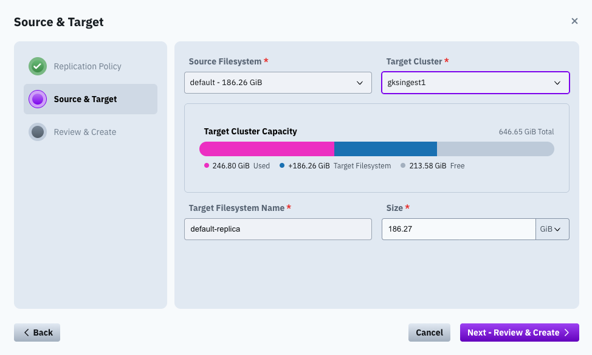<figcaption>
Add Replication Pair: Source &#x26; Target step (Full Data Replication)
</figcaption></figure>

7. In the **Review & Create** step, review the settings.
8. Select **Create Replication Pair**.

<figure>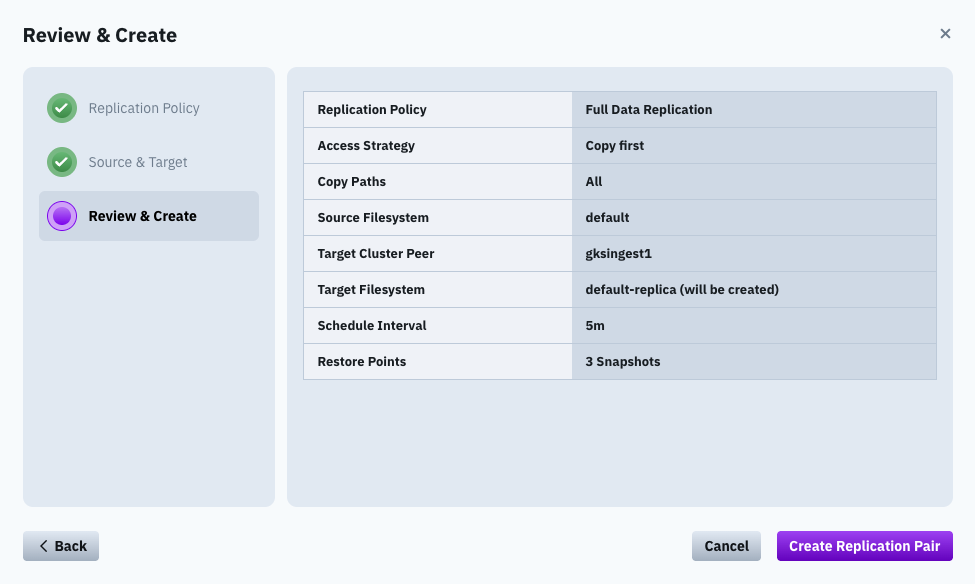<figcaption>
Add Replication Pair: Review &#x26; Create step
</figcaption></figure>

## View replication pairs

The **Replication Dashboard** tab summarizes replication at the top:

* **Replication Links:** The number of linked clusters.
* **Replicating Now:** The number of pairs in a replication cycle.
* **Health:** Healthy when no pair is Invalid. Lists the pairs that are Invalid or paused.
* **Next Scheduled Sync:** The next pair to start a cycle.

By default, the table shows the **Local Filesystem**, **Remote Filesystem**, **Progress**, **Status**, **Policy**, **Interval**, **Next Sync**, and **Copy Paths** columns. A **Source** or **Target** tag next to each filesystem name shows its role.

**Restore Points** is hidden by default. To show it or **Access Strategy**, select **Table Settings**.

Pairs on the target cluster have the **Target** role and no actions. Manage those pairs from the source cluster.

<figure><figcaption>
Replication Dashboard with replication pairs
</figcaption></figure>

**Status** shows the pair state: Syncing, Idle, Paused, Deleting, or Invalid. The CLI reports this state as Error.

For a pair in **Invalid**, point to **Status** to view the error code.

During a replication cycle, **Progress** shows the current phase:

| Phase                                                    | Meaning                                                                              |
| -------------------------------------------------------- | ------------------------------------------------------------------------------------ |
| Creating Snapshot                                        | Creates a snapshot of the source filesystem.                                         |
| Syncing Metadata                                         | Copies snapshot metadata to the target.                                              |
| Full Data Replication                                    | Copies metadata and data to the target. Applies only to Full Data Replication pairs. |
| Pulling Data                                             | Copies data for pre-copy paths from the source to the target.                        |
| Applying Snapshot on Target                              | Applies the snapshot to the target filesystem.                                       |
| Deleting Snapshot on Target, Deleting Snapshot on Source | Deletes snapshots that exceed the restore points limit.                              |

To filter the table, select a **Status** or **Link** value. The table shows only pairs that match the selected value.

## Edit the replication policy

1. On the **Replication Dashboard** tab, open the actions menu of the pair, and select **Edit Replication Policy**.

<figure>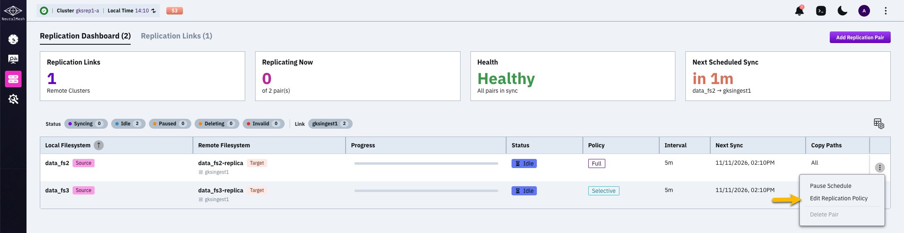<figcaption>
Edit replication policy menu
</figcaption></figure>

2. Change the policy, **Paths to Pre-Copy** (Selective Replication only), **Schedule**, **Sync Interval**, or **Restore Points on Target**, and then select **Approve**.




<figure>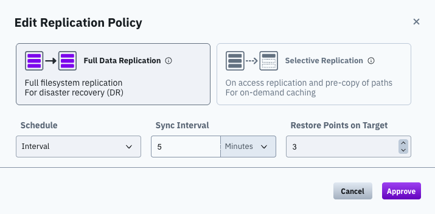<figcaption>
Edit Replication Policy: Full Data Replication
</figcaption></figure>





<figure>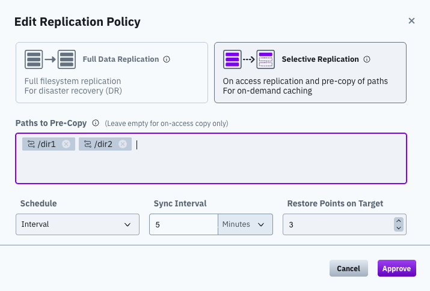<figcaption>
Edit Replication Policy: Selective Replication
</figcaption></figure>





A pair created from the CLI with a policy that the GUI does not offer shows its policy as managed from the CLI. Edit it with `weka replication fs-pair update`.


## Pause and resume a replication pair

Pause a pair before planned maintenance or before removing it. Resume the pair to continue replication.

On the **Replication Dashboard** tab, open the actions menu of the pair, and select **Pause Schedule** or **Resume Schedule**.

<figure>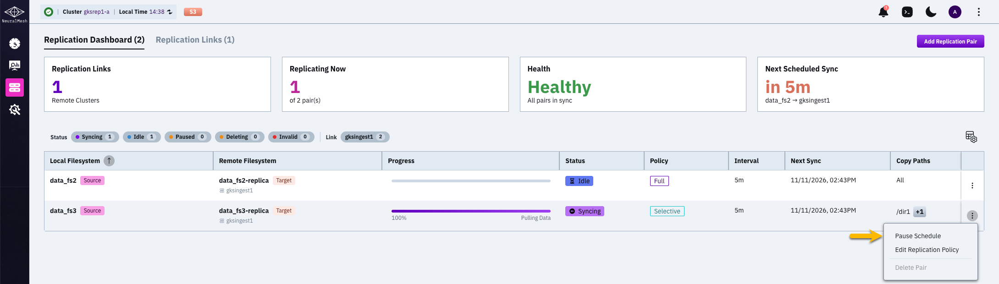<figcaption>
Pause a replication schedule
</figcaption></figure>

## Delete a replication pair

**Before you begin**

Pause the pair, and wait until its current cycle finishes. Until then, **Delete Pair** is unavailable. To delete a pair in Invalid, use the CLI: `weka replication fs-pair remove`.

**Procedure**

1. On the **Replication Dashboard** tab, open the actions menu of the pair, and select **Delete Pair**.
2. Confirm the deletion.


The deletion removes the pair from both clusters. To delete only the local pair when the other cluster is unreachable, select **Local only pair** in the confirmation dialog. After you delete the pair, the target filesystem remains write-protected. To make it writable, run `weka fs update <target filesystem> --access rw` on the target cluster.


## Update a replication link

Update a link when the other cluster moves to a new management address or port. The cluster rediscovers the addresses, ports, and configuration of the other cluster from the address you enter. Both clusters store the updated link.

**Procedure**

1. From the menu, select **Manage > Replication**, and then select the **Replication Links** tab.
2. Open the actions menu of the link, and select **Update**.
3. In the **Update Replication Link** dialog, enter the remote cluster's **Management IP or Host Name** and **Management Port**.
4. Select **Discover & Update**.

<figure><figcaption>
Update Replication Link
</figcaption></figure>

5. In **Compare Peer Cluster Fingerprint**, verify that the displayed fingerprint matches the remote cluster's fingerprint. On the remote cluster, run: `weka security tls status`.
6. Select **Update**.

<figure>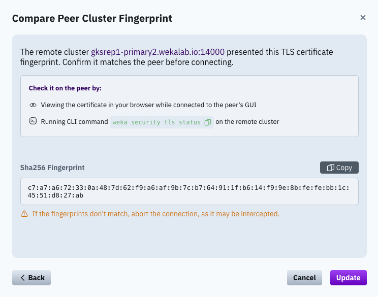<figcaption>
Update Replication Link: Compare Peer Cluster Fingerprint
</figcaption></figure>


If the link shows **Unpaired**, **Update** is unavailable because the other cluster no longer holds the link. Remove the link and add it again.


## Remove a replication link

Remove a replication link after deleting every replication pair that uses it. Removing a link also removes it from the other cluster.

**Before you begin**

Delete every replication pair that uses the link. Until then, **Remove Link** is unavailable.

**Procedure**

1. From the menu, select **Manage > Replication**, and then select the **Replication Links** tab.
2. Open the actions menu of the link, and select **Remove Link**.
3. Confirm the removal.

**Related topics**

[Asynchronous replication](./)

[Manage asynchronous replication using the CLI](manage-asynchronous-replication.md)
