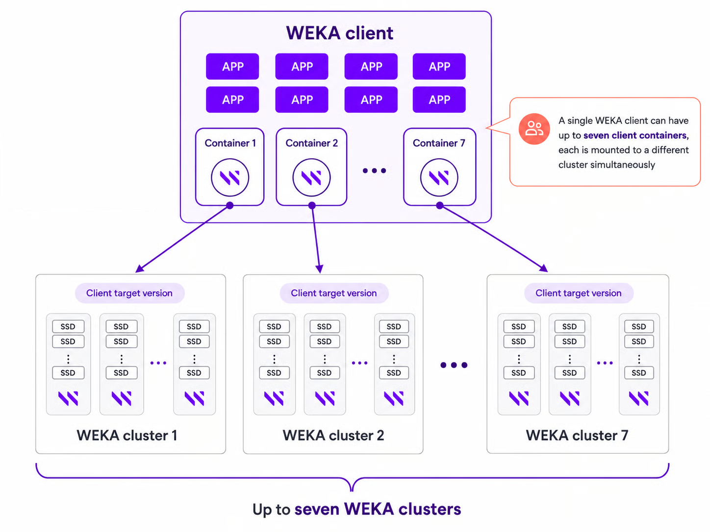

# Mount filesystems from Single Client to Multiple Clusters (SCMC)

## Overview

Mounting filesystems from a single stateless WEKA client to multiple clusters provides the following benefits:

* **Expanded cluster connectivity:** A single stateless client can establish connections with up to seven clusters concurrently, thereby increasing the aggregate storage capacity and computational resources available.
* **Unified data access:** Enables a consolidated view of data across multiple clusters, streamlining data access and management while improving availability, flexibility, and overall resource utilization.
* **Optimized workload distribution:** Facilitates the efficient distribution of workloads across clusters, supporting scalable application deployments and enhancing system performance.
* **Seamless integration:** The WEKA SCMC feature ensures reliable and efficient integration for stateless clients requiring access to multiple clusters.

<div data-with-frame="true"><figure><figcaption><p>Mount filesystems from Single Client to Multiple Clusters (SCMC)</p></figcaption></figure></div>

### **Bandwidth division considerations in SCMC**

The bandwidth division in SCMC is a universal consideration based on the specific NIC's bandwidth. It applies across various NIC types, including those using DPDK or specific models like the X500-T1.

During SCMC mounts, each active connection can use the bandwidth available on its associated NIC port. This is true during peak usage and idle cases. In scenarios where NICs are dual-ported, each connection operates independently, leveraging its dedicated port.

When working with low-bandwidth NICs such as the X500-T1, a 10Gb/s NIC, consider bandwidth calculations. In the context of SCMC, each container (representing connectivity to a different cluster) uses half of the available bandwidth (5Gb/s) for a shared port. Note that a dual-port NIC has a dedicated port for each container, optimizing bandwidth distribution. Keep these factors in mind for an optimal SCMC setup.

## Prerequisites

Ensure the following requirements are met:

* All clusters that run in this configuration must be at least version 4.2.
* Client containers can run different WEKA versions. The frontend of every client container must support the kernel driver loaded on the client. The client version must be the same as the cluster or, at most, one version earlier.
* All client containers must be configured as stateless clients.
* Each client container must run on its port. The default ports are 14000, 14101, 14201, 14301, 14401, 14501, and 14601. Ensure these ports allow egress on the client and ingress on the cluster.
* For DPDK, each client container must have 5 GB of free RAM, and it is recommended to have a dedicated CPU core to get optimal performance.

Mounting a filesystem without these requirements may fail or overload the WEKA client.

## Set the client target version in the clusters

When a stateless client mounts a filesystem in a cluster, it creates a client container with the same version as provided by the cluster. Because there may be situations where some of the clusters run a different WEKA version than the others, such as during an upgrade, it is required to set the same client target version on all clusters. The client target version is retained regardless of the cluster upgrade.


The client target version must be consistent across all clusters. It can match the cluster version or be one major version earlier (regardless the minor), provided that version is available in the cluster for client download.

To upgrade the cluster to a version higher than the first major release above the client version, see [upgrading-weka-versions](../../operation-guide/upgrading-weka-versions/ "mention").


#### Procedure:

1. Connect to each cluster and run the following command to set the client target version.

```bash
weka cluster client-target-version set <version>
```

Where: `<version>` is the designated client target version, which will be installed on the client container upon the mount command. Ensure this version is installed on the backend servers.

2. To display the existing client target version in the cluster, run the following command:

```bash
weka cluster client-target-version show
```

3. To reset the client target version to the cluster version, run the following command:

```bash
weka cluster client-target-version reset
```

## Mount a stateless client container on multiple clusters

Use the same commands as with a single client.


```bash
mount -t wekafs <backend-name> <fs-name> <mount-point> -o container_name=<container-name>
```


To mount a stateless client using UDP mode, add `-o net=udp,core=<core-id>` to the command line. For example:


```bash
mount -t wekafs backend-server-0/my_fs /mnt/weka -o net=udp,core=2,container_name=frontend0
```


## Run commands from a server with multiple client containers

When running WEKA CLI commands from a server hosting multiple client containers, each connected to a different WEKA cluster, it’s required to specify the client container port or the backend IP address/name of the cluster (linked to that client) in the command.

Consider a server with two client containers:

```bash
weka local ps
CONTAINER  STATE    DISABLED  UPTIME    MONITORING  PERSISTENT  PORT   PID    STATUS  VERSION LAST FAILURE
client1    Running  False     3:15:57h  True        False       14000  58318  Ready   4.3.0
client2    Running  False     3:14:35h  True        False       14101  59529  Ready   4.3.0
```

To run a WEKA CLI command on the second cluster (associated with `client2`), use either of the following methods:

*   By specifying the backend IP address or name linked to that client container (assuming the backend name is `DataSphere2-1`):

    ```
    weka status -H DataSphere2-1
    ```
*   By specifying the client container port:

    ```
    weka status -P 14101
    ```

This approach ensures that your WEKA CLI command targets the correct WEKA cluster associated with the specified client container.

## Manage the kernel driver on a client with multiple clusters

All client containers on a host share one WEKA kernel driver. The driver is decoupled from the WEKA version of the client containers, so a single client can connect to clusters that run different WEKA versions. The frontend of each client container must support the loaded driver.

* **Upgrade a client:** A client upgrade replaces only the client container and keeps the loaded driver by default.
* **Replace the driver:** Add `--force-driver` to `weka local upgrade`, or to the remote clients upgrade, to replace the driver during an upgrade. All client containers on the host drain while the driver is replaced.
* **Declare the driver version:** Set a driver target version on each cluster. It names the WEKA version whose driver the clients of that cluster load. When several clusters declare different versions, the client loads the oldest declared version. When a cluster declares none, its clients use the version of their own client container.
* **Validation:** The system rejects a driver target version that is incompatible with the client target version when you set it. A mount is refused when the client container cannot use the loaded driver.

**Driver compatibility rules**

* A client container can use the driver from its own WEKA release or from an earlier release, never from a later release.
* Client containers on releases before 5.1.50 can use only the driver from their own release.
* Drivers from releases before 5.1.32 cannot be used by any later release.
* A driver target version must be compatible with the client target version of the cluster, and with every client container registered in the cluster, including stopped containers.

**If a mount is refused because the host already runs a driver the cluster's clients cannot use**

1. On the cluster whose client container loaded the driver, run `weka cluster driver-target-version set <version>`. Set `<version>` to the WEKA release of the cluster you want to mount.
2. On the host, run `weka local upgrade --all --force-driver` to load that driver. All client containers on the host drain and restart.

Alternatively, mount the filesystem on a different host.

To declare the driver version, connect to each cluster and run the following command.


```
weka cluster driver-target-version set <version>
```


To display the driver target version of the cluster, run the following command.


```
weka cluster driver-target-version show
```


To remove the declaration and return to the default, run the following command.


```
weka cluster driver-target-version reset
```


#### Related topics

[add-clients.md](../../planning-and-installation/system-installation-on-bare-metal-servers/add-clients.md "mention")

[.](./ "mention")
